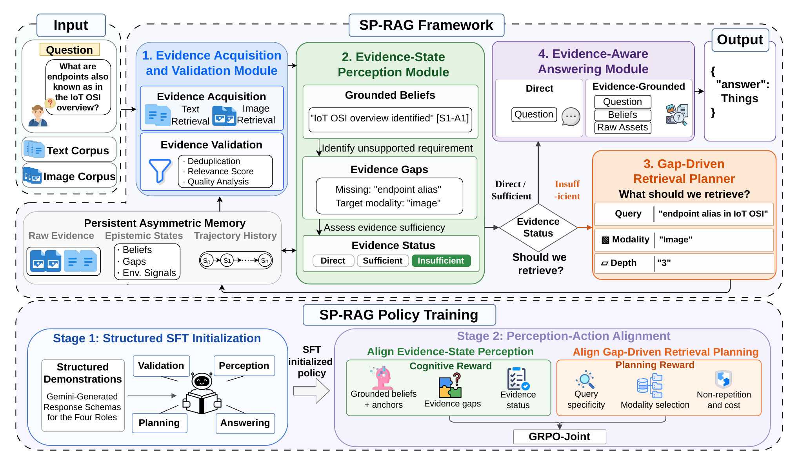

# SP-RAG

**Self-Perceiving Multimodal Retrieval-Augmented Generation**

Multimodal retrieval-augmented generation (MM-RAG) must decide not only what to retrieve, but also whether the current text and image evidence is reliable and sufficient. SP-RAG addresses this problem with an **Acquire--Assess--Decide--Plan** loop built around a persistent, provenance-grounded evidence state.

At each step, SP-RAG retrieves multimodal evidence, validates its relevance, updates supported beliefs and unresolved information gaps, decides whether the evidence is sufficient, and plans the next query, modality, and retrieval depth. The method is trained in two stages: structured supervised fine-tuning (SFT) initializes the role interfaces, and GRPO process rewards align cognitive assessment and retrieval planning.

In the controlled Qwen2.5-VL-7B comparison reported in our paper, SP-RAG improves average accuracy by **16.58%** while using **1.58 fewer retriever calls** than the strongest matched multi-round baseline.

Project page: <https://github.com/zyn20240072/SP-RAG>

## Framework

<p align="center">
  <a href="final_images/SP-RAG%20v2.drawio.pdf">
    
  </a>
</p>

<p align="center"><em>SP-RAG maintains a persistent evidence state to assess retrieval sufficiency, plan gap-driven retrieval, and produce evidence-aware answers. Click the figure to open the vector PDF.</em></p>

## Released Models

The trained SP-RAG checkpoints are available on ModelScope:

| Checkpoint | ModelScope |
| --- | --- |
| SP-RAG-Qwen3.5-VL-4B | [zyn20240072/SP-RAG-Qwen3.5-VL-4B](https://modelscope.cn/models/zyn20240072/SP-RAG-Qwen3.5-VL-4B) |
| SP-RAG-Qwen2.5-VL-7B | [zyn20240072/SP-RAG-Qwen2.5-VL-7B](https://modelscope.cn/models/zyn20240072/SP-RAG-Qwen2.5-VL-7B) |

Download a checkpoint with the ModelScope SDK:

```bash
pip install -U modelscope
```

```python
from modelscope import snapshot_download

model_dir = snapshot_download("zyn20240072/SP-RAG-Qwen3.5-VL-4B")
# Or: snapshot_download("zyn20240072/SP-RAG-Qwen2.5-VL-7B")
```

Use the downloaded directory as the model path in your vLLM or other OpenAI-compatible multimodal serving setup.

## Method Overview

SP-RAG separates the iterative workflow into four operations:

1. **Acquire**: retrieve text and image candidates with modality-specific queries.
2. **Assess**: validate each asset and retain its provenance, retrieval history, and relevance score.
3. **Decide**: maintain a grounded belief state and determine whether the available evidence is sufficient.
4. **Plan**: identify missing information and generate the next query, modality, and retrieval depth.

The current implementation includes:

- a bounded multi-step agent with validator, cognitive controller, planner, and responder roles;
- provenance checks that only admit beliefs linked to stored evidence;
- soft evidence admission using validator scores, repeated hits from distinct queries, and protected initial anchors;
- configurable context and evidence budgets for cognitive and final-answer generation;
- independent, intersection-priority, and reciprocal-rank-fusion retrieval strategies;
- resumable, multi-process JSONL inference with per-item error isolation;
- SFT and GRPO training templates for Qwen2.5-VL-style models.

Figures from the paper are available in [`final_images/`](final_images/), including the [SP-RAG framework](final_images/SP-RAG%20v2.drawio.pdf), [MM-RAG task formulation](final_images/mmrag%E2%80%94task.drawio.pdf), [case study](final_images/casestudy.drawio.pdf), and [SFT scaling result](final_images/sft_scale.pdf).

## Repository Structure

```text
.
├── infer_code/                         # Online inference pipeline
│   ├── main.py                         # Resumable dataset-level runner
│   ├── agent.py                        # Acquire--Assess--Decide--Plan loop
│   ├── llm_roles.py                    # Role prompts and structured parsing
│   ├── memory_system.py                # Evidence, belief, and trace state
│   ├── data_schemas.py                 # Pydantic schemas
│   ├── api_handler.py                  # OpenAI-compatible multimodal client
│   ├── retriever.py                    # Default BGE + Chroma retrieval
│   ├── retriever_gme.py                # Optional GME retrieval client
│   ├── tools.py                        # Text/image search interface
│   └── config.py                       # Runtime, model, dataset, and path settings
├── retrieval_part/
│   ├── bgem3_service.py                # BGE-M3 text embedding service
│   ├── bgevl_service.py                # BGE-VL image/query embedding service
│   └── prepare/
│       ├── get_ocr.py                  # OCR extraction
│       ├── pack_cleanocr.py            # OCR cleanup and JSONL packing
│       └── embedding_store_v3.py       # Text/table/image Chroma indexing
├── train_code/
│   ├── SFT/run_sft.sh                 # Structured SFT template
│   └── RL/
│       ├── grpo_vrag_v9_vllm_cog_plan.sh
│       ├── plugin_vrag_v18.py          # GRPO reward plugin
│       ├── plugin_vrag_v18_qwen3_5.py  # Qwen3.5-compatible variant
│       ├── reward_utils.py
│       ├── retriever.py
│       └── tools.py
└── final_images/                       # Paper and project figures
```

## Reproducibility Scope

This repository contains the inference, retrieval-index preparation, and training code. It does **not** include benchmark data, image corpora, Chroma indices, base-model weights, or checkpoint binaries. The released SP-RAG checkpoints are hosted separately on ModelScope in the [Released Models](#released-models) section. Several scripts retain machine-specific example paths and GPU settings from our experiments; replace them before running.

The checked-in scripts should therefore be treated as reproducibility references rather than zero-configuration launchers.

## Benchmarks and Dataset Sources

The dataset names in `infer_code/config.py` are local identifiers. They map to the following public benchmarks:

| Config name | Benchmark | Paper | Data / code |
| --- | --- | --- | --- |
| `mmlongbench` | MMLongBench-Doc | [Ma et al., NeurIPS 2024](https://papers.nips.cc/paper_files/paper/2024/hash/ae0e43289bffea0c1fa34633fc608e92-Abstract-Datasets_and_Benchmarks_Track.html) | [Official repository](https://github.com/mayubo2333/MMLongBench-Doc) |
| `mutihop` | MultiModalQA | [Talmor et al., ICLR 2021](https://openreview.net/forum?id=ee6W5UgQLa) | [Official project](https://allenai.github.io/multimodalqa/) |
| `videoseek` | ViDoSeek | [Wang et al., EMNLP 2025](https://aclanthology.org/2025.emnlp-main.464/) | [Dataset](https://huggingface.co/datasets/Qiuchen-Wang/ViDoSeek) |
| `slide` | SlideVQA | [Tanaka et al., AAAI 2023](https://doi.org/10.1609/aaai.v37i11.26598) | [Official repository](https://github.com/nttmdlab-nlp/SlideVQA) |

SP-RAG does not redistribute these datasets. Download them from their official sources, follow their respective licenses and terms, and cite the corresponding papers when reporting results. The `mutihop` spelling is retained in the code as the internal identifier for MultiModalQA.

### Dataset Citations

When reporting results on these benchmarks, please cite their original papers:

```bibtex
@inproceedings{ma2024mmlongbenchdoc,
  title     = {{MMLongBench-Doc}: Benchmarking Long-context Document Understanding with Visualizations},
  author    = {Ma, Yubo and Zang, Yuhang and Chen, Liangyu and Chen, Meiqi and
               Jiao, Yizhu and Li, Xinze and Lu, Xinyuan and Liu, Ziyu and
               Ma, Yan and Dong, Xiaoyi and Zhang, Pan and Pan, Liangming and
               Jiang, Yu-Gang and Wang, Jiaqi and Cao, Yixin and Sun, Aixin},
  booktitle = {Advances in Neural Information Processing Systems},
  volume    = {37},
  pages     = {95963--96010},
  year      = {2024},
  doi       = {10.52202/079017-3041}
}

@inproceedings{talmor2021multimodalqa,
  title     = {{MultiModalQA}: Complex Question Answering over Text, Tables and Images},
  author    = {Talmor, Alon and Yoran, Ori and Catav, Amnon and Lahav, Dan and
               Wang, Yizhong and Asai, Akari and Ilharco, Gabriel and
               Hajishirzi, Hannaneh and Berant, Jonathan},
  booktitle = {International Conference on Learning Representations},
  year      = {2021},
  url       = {https://openreview.net/forum?id=ee6W5UgQLa}
}

@inproceedings{wang-etal-2025-vidorag,
  title     = {{ViDoRAG}: Visual Document Retrieval-Augmented Generation via Dynamic Iterative Reasoning Agents},
  author    = {Wang, Qiuchen and Ding, Ruixue and Chen, Zehui and Wu, Weiqi and
               Wang, Shihang and Xie, Pengjun and Zhao, Feng},
  booktitle = {Proceedings of the 2025 Conference on Empirical Methods in Natural Language Processing},
  pages     = {9113--9134},
  year      = {2025},
  doi       = {10.18653/v1/2025.emnlp-main.464},
  url       = {https://aclanthology.org/2025.emnlp-main.464/}
}

@article{tanaka2023slidevqa,
  title   = {{SlideVQA}: A Dataset for Document Visual Question Answering on Multiple Images},
  author  = {Tanaka, Ryota and Nishida, Kyosuke and Nishida, Kosuke and
             Hasegawa, Taku and Saito, Itsumi and Saito, Kuniko},
  journal = {Proceedings of the AAAI Conference on Artificial Intelligence},
  volume  = {37},
  number  = {11},
  pages   = {13636--13645},
  year    = {2023},
  doi     = {10.1609/aaai.v37i11.26598}
}
```

## Environment

Python 3.10 or later is required. The default pipeline uses local GPU services for generation and embedding.

Install the core inference and retrieval dependencies:

```bash
pip install openai httpx pillow tqdm numpy requests "pydantic>=2" json-repair
pip install langchain langchain-community langchain-core chromadb
pip install fastapi uvicorn torch transformers FlagEmbedding
```

OCR preparation additionally requires:

```bash
pip install paddleocr opencv-python
```

Training requires [ms-swift](https://github.com/modelscope/ms-swift) and the DeepSpeed, FlashAttention, and vLLM versions compatible with your CUDA, PyTorch, and Qwen-VL environment.

## Prepare the Retrieval Corpus

### 1. Configure corpus paths

Edit `retrieval_part/prepare/embedding_store_v3.py` and set:

- `persist_directory`: output root for the Chroma indices;
- `JSON_DATASETS`: text and table source files;
- `IMAGE_FOLDER_DATASETS`: image corpus directories.

The image-index loop at the bottom of the script is commented out by default. Enable it when image indices need to be created.

If OCR is required, first update the dataset and path constants in:

- `retrieval_part/prepare/get_ocr.py`;
- `retrieval_part/prepare/pack_cleanocr.py`.

`pack_cleanocr.py` removes empty OCR text files in its current form. Back up raw OCR output if it must be preserved.

### 2. Start the embedding services

Run the two services in separate terminals from the repository root:

```bash
python retrieval_part/bgem3_service.py
```

```bash
python retrieval_part/bgevl_service.py
```

The default endpoints are:

| Purpose | Endpoint |
| --- | --- |
| BGE-M3 text embedding | `http://localhost:8500/bge-m3-embed` |
| BGE-VL image embedding | `http://localhost:8005/embed` |
| BGE-VL text-to-image query embedding | `http://localhost:8005/query_embed` |

Both service files currently set `CUDA_VISIBLE_DEVICES` internally. Change or remove that setting to match your machine.

### 3. Build the indices

```bash
python retrieval_part/prepare/embedding_store_v3.py
```

The default inference retriever expects the following layout and collection names:

```text
<PERSIST_DIR_PRE>/<dataset>/text    collection: <dataset>_text_data
<PERSIST_DIR_PRE>/<dataset>/image   collection: <dataset>_image_data
<PERSIST_DIR_PRE>/mutihop/table     collection: mutihop_table_data
```

## Configure Inference

Edit `infer_code/config.py` before the first run:

- set `PERSIST_DIR_PRE` to the Chroma root created above;
- update `ALL_DATASET_CONFIGS` with each input JSONL, output JSONL, and image root;
- adjust retrieval limits, evidence budgets, validator settings, and process count if needed.

The generation model is accessed through an OpenAI-compatible API. Its main settings can be supplied without editing the file:

```bash
export RAG_MODEL_NAME="your-served-model-name"
export RAG_API_BASE="http://localhost:8160/v1"
export RAG_API_KEY="your-api-key-if-required"
export RAG_EXPERIMENT_NAME="my_experiment"
export RAG_RETRIEVAL_STRATEGY="intersect"
export RAG_NUM_PROCESSES=6
```

Core runtime environment variables are:

| Variable | Default | Description |
| --- | --- | --- |
| `RAG_MODEL_NAME` | `cog_plan` | Model name sent to the generation server |
| `RAG_API_BASE` | `http://localhost:8160/v1` | OpenAI-compatible API base URL |
| `RAG_API_KEY` | empty | API key, when required |
| `RAG_RETRIEVAL_STRATEGY` | `intersect` | `independent`, `intersect`, or `union_rrf` |
| `RAG_NUM_PROCESSES` | `6` | Number of inference worker processes |
| `RAG_EXPERIMENT_NAME` | code default | Suffix used in configured output filenames |
| `RAG_SYSTEM_PROMPT` | unset | Optional path to a custom system prompt |
| `RAG_STRICT_CORPUS_PATH` | `1` | Fail instead of silently creating an empty Chroma corpus |
| `RAG_API_TIMEOUT` | `300` | Generation request timeout in seconds |
| `RAG_EMBEDDING_TIMEOUT` | `20` | Embedding request timeout in seconds |
| `RAG_IMAGE_MAX_SIDE` | `1024` | Maximum image side sent to the generation API |

All roles use the same endpoint by default. To serve different models for different roles, replace the generated `ROLE_MODEL_CONFIGS` mapping in `infer_code/config.py` with role-specific entries.

## Data Format

Inference reads JSONL with one question per line. `question` is required; `question_id` is recommended and is generated from the line number when absent.

```json
{
  "question_id": "example-id",
  "question": "Question text"
}
```

The runner preserves the input fields and appends `final_answer` and a detailed `agent_trace`:

```json
{
  "question_id": "example-id",
  "question": "Question text",
  "final_answer": "Predicted answer",
  "agent_trace": {
    "original_question": "Question text",
    "execution_trace": [],
    "all_assets_summary": {},
    "final_validations_map": {},
    "final_selected_asset_ids": []
  }
}
```

The trace also records the grounded belief/evidence state, retrieval history, responder reasoning when available, provenance mappings, repeat-hit statistics, and admission scores.

## Run Inference

Start an OpenAI-compatible multimodal generation server separately, then run from the repository root so the relative paths in `infer_code/config.py` resolve consistently:

```bash
python infer_code/main.py
```

The runner processes every entry in `ALL_DATASET_CONFIGS`, isolates failures by sample, writes errors to `processing_errors.log`, and resumes by skipping `question_id` values already present in each output JSONL file.

### Retrieval strategies

- `independent`: executes text and image actions separately and keeps their ranked results modality-specific.
- `intersect`: prioritizes assets whose normalized identifiers agree across text and image retrieval, then backfills from each modality ranking; it is a priority rule rather than a hard intersection filter.
- `union_rrf`: combines text and image candidates with reciprocal-rank fusion.

Example:

```bash
RAG_RETRIEVAL_STRATEGY=union_rrf python infer_code/main.py
```

## Optional GME Retriever

`infer_code/retriever_gme.py` provides an experimental client for a GME embedding service and GME-built Chroma corpora. It is not selected by `infer_code/tools.py` in the default pipeline, and the corresponding embedding service is not included in this repository.

The client expects `POST /gme/text` and `GET /health` endpoints by default. Configure it with `GME_BASE_URL`, `GME_TEXT_ENDPOINT`, `GME_HEALTH_ENDPOINT`, and `GME_CORPUS_ROOT`. A corpus/service preflight is available with:

```bash
python infer_code/retriever_gme.py
```

## Training

Training follows the two-stage recipe used by SP-RAG.

### Stage 1: structured SFT

Update the base model, dataset, output directory, GPU thresholds, and DeepSpeed settings in `train_code/SFT/run_sft.sh`, then launch:

```bash
bash train_code/SFT/run_sft.sh
```

### Stage 2: cognitive/planning GRPO

Update the model, GRPO dataset, output directory, GPU settings, logging credentials, and retrieval paths in `train_code/RL/`. Then launch the GRPO template:

```bash
bash train_code/RL/grpo_vrag_v9_vllm_cog_plan.sh
```

The RL launcher uses `plugin_vrag_v18.py` and the registered `agentic_rag_reward`. `plugin_vrag_v18_qwen3_5.py` contains the corresponding Qwen3.5-oriented parsing and reward variant. Check plugin resolution against your ms-swift version and launch directory before starting a long run.

Both launchers wait for GPUs meeting hard-coded free-memory thresholds. Adjust `TARGET_FREE_MEM`, `TARGET_GPU_COUNT`, and `CHECK_INTERVAL` for your cluster.
